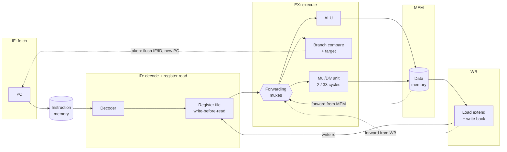
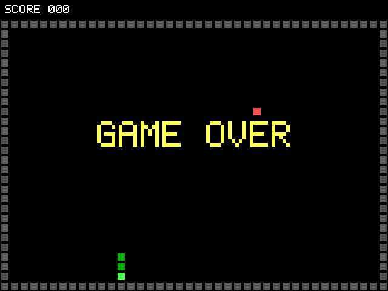

# rv32im-core

A complete computer built from the CPU up: a 5-stage RV32IM RISC-V CPU in
SystemVerilog, grown into a system-on-chip on the Terasic DE10-Lite (Intel MAX 10,
10M50) with SDRAM, UART, timer, GPIO, VGA graphics, and my INT8 systolic array
([edge-ml-accelerator](https://github.com/hridhayesh09/edge-ml-accelerator)) attached as an AI accelerator.

## Status

| Stage | What | Status |
|---|---|---|
| 0 | Toolchain, repo skeleton, CI | done |
| 1 | 5-stage RV32IM pipeline, riscv-tests, Spike lockstep, random tests, C programs | done |
| 2 | SoC: Wishbone bus, boot ROM, SDRAM, UART, timer, GPIO, UART bootloader | **runs on the DE10-Lite**: bootloader, hello, 64 MB SDRAM test ([board log](docs/results/board_2026-11-07.md)) |
| 3 | VGA framebuffer, graphics driver, a playable game | **runs on the DE10-Lite**: Snake playable on a real VGA monitor with the board's buttons |
| 4 | Systolic array accelerator, MNIST software vs accelerator | **runs on the DE10-Lite**: 16x16 NPU, MNIST bit-exact, 38.49x faster than software |
| 5 | I/D caches, branch predictor, CoreMark, measured tradeoffs | done on the board; cost table in progress |
| Doom | doomgeneric with picolibc, 8-bit VGA mode, keyboard over the UART | **runs on the DE10-Lite**: playable with the laptop's keyboard, 11.7 fps in Doom's timedemo |
| 6 | OpenLane on Sky130 | flow, ASIC top level and gate-level test ready ([docs/asic.md](docs/asic.md)); needs Nix installed to run |

The full plan for each stage is in [docs/roadmap.md](docs/roadmap.md).
Plain-English explanations of every part of the design, with interview questions,
are in [docs/notes.md](docs/notes.md).

## The CPU



- **5 stages**, in order: IF → ID → EX → MEM → WB, with synchronous-read memories (FPGA block RAM style).
- **Forwarding** from MEM and WB into EX, plus write-before-read in the register file.
- **Load-use stall:** one bubble when an instruction uses a load result right away.
- **Branch prediction** in IF: a 32-entry BTB, gshare (256 2-bit counters, 8 bits of history) and a
  4-entry return-address stack. Branches resolve in EX; a mispredict flushes 2 instructions.
- **Caches** (when running from SDRAM): 4 KB instruction and data caches, write-back, direct-mapped or 2-way.
- **Multiply/divide unit:** 2 extra cycles per multiply, 33 per divide; EX stalls until done.
- **Retire trace** (`rvfi_*`) used to compare every instruction against Spike.

## Results

All numbers come from `make test` (Verilator 5.036, Spike, GCC 13.2.0) unless noted.

**Verification**

| Check | Result |
|---|---|
| Unit tests: ALU, register file, decoder, mul/div unit against Python models | pass |
| Official riscv-tests rv32ui, in lockstep with Spike | **42 / 42** pass (misaligned accesses trap and are emulated by a handler, [how](docs/notes.md#stage-5-step-1-exceptions-and-csrs)) |
| Official riscv-tests rv32um, in lockstep with Spike | **8 / 8** pass (2,181 instructions compared) |
| Directed programs (forwarding, load-use, flush, mul/div, FENCE.I, traps and CSRs, branch prediction) in lockstep | 9 / 9 pass |
| Random RV32IM programs in lockstep (20 per CI run) | pass; a local 300-program run (`RANDOM_PROGRAMS=300 make test`) compared 140,887 instructions with 0 mismatches |
| C programs (GCC -O2) in lockstep | 3 / 3 pass |
| All of the above again with random wait states on every data access | pass |
| All of the above again through tiny caches (direct-mapped and 2-way), and with no / tiny bimodal / tiny gshare predictors | pass |

**Performance in simulation** (cycles from reset until the program reports its result)

| Program | Instructions | CPI, no prediction | CPI, bimodal | CPI, gshare | CPI, gshare + RAS (default) |
|---|---|---|---|---|---|
| fib (recursive + iterative Fibonacci) | 176,516 | 1.152 | 1.063 | 1.043 | 1.042 |
| sort (quicksort of 256 numbers) | 29,513 | 1.298 | 1.143 | 1.160 | 1.153 |
| primes (trial division up to 2000) | 72,250 | 6.977 | 6.620 | 6.560 | 6.560 |

The ideal CPI for this pipeline is 1. The extra cycles come from mispredicted branches (2 cycles
each), load-use stalls (1 cycle) and divides (33 cycles each), which is why `primes`, full of `%`,
is the slowest. (`python tools/bp_sweep.py`; 1-cycle memory, simulation.)

**Doom on the board** ([board log](docs/results/board_2026-11-11.md#doom), [how it works](docs/notes.md#doom))

Freedoom Phase 1 on the CPU-only build (4 KB caches, everything in SDRAM, 320x200 in 256 colours on
the VGA monitor), played with the laptop's keyboard over the serial port (`tools/doom_keys.py`).

| Doom's benchmark (`-timedemo demo1`) | Result |
|---|---|
| Game tics drawn | 7,117 in 607 s |
| **Frames per second** | **11.7** (5-second windows: 7.4 to 14.7) |

**CoreMark on the board** (EEMBC CoreMark 1.0, 2K performance run, 2000 iterations, GCC 13.2 -O2;
[board log](docs/results/board_2026-11-11.md))

| Build | Program in | CoreMark/MHz | CoreMark at 50 MHz | CPI |
|---|---|---|---|---|
| Full SoC or CPU-only | on-chip RAM | **2.699** | 134.9 | 1.177 |
| CPU-only, 4 KB I$ + 4 KB D$ | SDRAM through the caches | **2.661** | 133.0 | 1.194 |

**MNIST on the board** (784 → 64 → 10, int8; [board log](docs/results/board_2026-11-11.md))

| | Images | Correct | Cycles per image | Time per image at 50 MHz |
|---|---|---|---|---|
| CPU only (software) | 10 | 10 | 847,536 | 17.0 ms |
| CPU + 16x16 NPU | 200 | 199 (99.5 %) | 21,172 | 423 us |

**Speedup: 40.03x**, and every logit of every image is bit-exact with the NumPy int8 model.

**FPGA build** (Quartus Prime Lite 25.1, DE10-Lite / 10M50, whole SoC: CPU, SDRAM, VGA, 16x16 NPU)

A CPU-only build with 4 KB instruction and data caches and the 8-bit VGA mode (no NPU; the Doom build) uses 14,059 LEs and 149 / 182 M9K and reaches 55.11 MHz.

| Logic elements | Memory bits | 9-bit multipliers | Fmax (slow, 85 °C) | Setup slack at 50 MHz |
|---|---|---|---|---|
| 35,646 (72 %) | 1,164,584 (69 %), 167 / 182 M9K | 136 (47 %) | 56.47 MHz | +2.292 ns |

**Snake on the CPU** (frame captured from the simulated VGA monitor; [how it's tested](docs/notes.md#stage-3-graphics))



## Getting started

Install the tools with [docs/setup.md](docs/setup.md), then:

```bash
make check-tools   # print every tool's version
make test          # all unit, ISA, random and C-program tests
```

## Repo layout

```
rtl/      SystemVerilog: core.sv (pipeline), alu, regfile, decoder, muldiv, dpram, wb_* peripherals
tb/       Verilator testbench top
tests/    unit/ (cocotb unit tests), core/ (lockstep runner, riscv-tests, random, C programs),
          asm/ (directed assembly tests), env/ (riscv-tests environment), riscv-tests/ (submodule)
sw/       crt0.S, link.ld, C programs
docs/     roadmap, setup, notes
```
