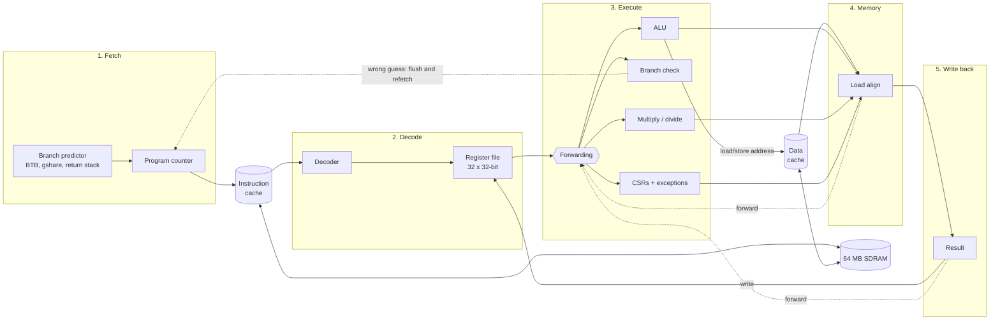

# rv32im-core

A computer built from the processor up: my own RISC-V CPU, written in SystemVerilog, running on an
FPGA board with memory, graphics and an AI accelerator. It runs Doom, and the same CPU has also been
taken all the way to a chip layout.

## The CPU



**In plain words:** every instruction goes through five steps, one per clock cycle, like an assembly
line, so five instructions are in flight at once. The CPU fetches an instruction, decodes it and
reads its registers, computes, accesses memory, and writes the result back. When an instruction needs
a result that isn't written back yet, *forwarding* hands it over early. For branches the CPU guesses
which way they go so it can keep fetching; when the guess is wrong, the two instructions fetched by
mistake are thrown away. Small caches keep recently used code and data on chip, so most accesses
don't wait for the slow external memory.

**In technical terms:**
- RV32IM with Zicsr, Zicntr and Zifencei; machine mode; single-issue, in order.
- 5 stages. Forwarding from MEM and WB; 1-cycle load-use stall. Loads and stores send their address
  from EX, and the loaded data is aligned and registered in MEM.
- Branch prediction in fetch: 32-entry BTB, gshare (256 2-bit counters, 8 bits of global history),
  4-entry return-address stack. Branches resolve in EX; a mispredict costs 2 cycles.
- 4 KB instruction cache and 4 KB write-back data cache (direct-mapped or 2-way, 16-byte lines).
- Multiply: 2 extra cycles; divide: 33 extra cycles.
- Precise exceptions, CSRs, MRET, performance counters (cycles, instructions, branches,
  mispredictions, stalls, cache misses).

How each part works, with interview questions: [docs/notes.md](docs/notes.md).

## Results

All measured on real runs; logs are linked.

| | Result |
|---|---|
| **Speed** | **2.70 CoreMark/MHz** on the board ([EEMBC CoreMark](https://github.com/eembc/coremark), valid 15 s run) |
| **Doom** | Plays on the board, **11.7 frames per second** in Doom's own benchmark |
| **AI accelerator** | Handwritten-digit recognition (MNIST) **40x faster** than the CPU alone, exactly the same answers |
| **Correctness** | Every instruction checked against the official RISC-V simulator; **591 tests** pass |
| **Chip layout** | Passes the chip-factory checks (DRC, LVS); **77.9 MHz** in SkyWater 130 nm |

### Running on the board

Terasic DE10-Lite (Intel MAX 10 FPGA), 50 MHz clock.
[Board log](docs/results/board_2026-11-11.md).

**CoreMark** (EEMBC CoreMark 1.0, 2000 iterations, GCC 13.2 `-O2`)

| Program runs from | CoreMark/MHz | CoreMark at 50 MHz | Cycles per instruction |
|---|---|---|---|
| On-chip RAM | **2.699** | 134.9 | 1.18 |
| SDRAM, through the 4 KB caches | **2.661** | 133.0 | 1.19 |

**Doom** (Freedoom, 320x200 in 256 colours on a VGA monitor, keyboard over the serial port;
[how it works](docs/notes.md#doom))

| Doom's benchmark (`-timedemo demo1`) | Result |
|---|---|
| Frames drawn | 7,117 in 607 s |
| **Frames per second** | **11.7** (7.4 to 14.7 depending on the scene) |

**MNIST on the 16x16 systolic-array accelerator** (784-64-10 network, 8-bit integers; from my
[edge-ml-accelerator](https://github.com/hridhayesh09/edge-ml-accelerator) project)

| | Images | Correct | Cycles per image | Time per image |
|---|---|---|---|---|
| CPU only | 10 | 10 | 847,536 | 17.0 ms |
| CPU + accelerator | 200 | 199 (99.5 %) | 21,172 | 423 µs |

40.03x faster, and every output is bit-exact with the reference NumPy model.

**Snake**, playable on a VGA monitor with the board's buttons (this frame is from the simulated
monitor):


### Verification

Every instruction the CPU finishes is compared with [Spike](https://github.com/riscv-software-src/riscv-isa-sim),
the reference RISC-V simulator, in lockstep. A mismatch anywhere fails the test.

| Check | Result |
|---|---|
| Official riscv-tests (rv32ui, rv32um) | **50 / 50** |
| Directed tests: forwarding, stalls, mul/div, FENCE.I, traps and CSRs, branch prediction | 9 / 9 |
| Random RV32IM programs (local run: 300 programs, 140,887 instructions) | 0 mismatches |
| C programs (GCC `-O2`) | 3 / 3 |
| All of the above with random memory delays, through tiny caches, and with each branch predictor | pass |
| System tests: UART, SDRAM, VGA frames checked pixel by pixel, bootloader, CoreMark, MNIST | pass |
| Final chip netlist (gate level) running the riscv-tests | **50 / 50** |

Bugs were planted on purpose to make sure the tests catch them. `make test` runs all 591 tests.

### FPGA build

Quartus Prime Lite 25.1, timing checked at the slow corner (85 °C).

| Build | Logic elements | Block RAMs (M9K) | Multipliers | Max clock |
|---|---|---|---|---|
| Full system with the accelerator | 35,772 of 49,760 | 168 of 182 | 136 of 288 | 56.97 MHz |
| CPU with caches and 256-colour VGA (the Doom build) | 13,946 | 149 | 8 | 51.96 MHz |

**What the CPU's features cost and gain** (Quartus cost against CoreMark in simulation;
[full table](docs/notes.md#stage-5-the-tradeoff-table))

| Change from the default | Logic elements | CoreMark/MHz |
|---|---|---|
| Default (gshare + return stack, 4 KB caches) | 14,059 | 2.698 from RAM, 2.649 from SDRAM |
| No branch predictor | -1,657 | 2.315 (-14 %) |
| 4x the predictor counters | +2,455 | 2.719 (+0.8 %) |
| 1 KB caches | -1,948 | 2.314 from SDRAM (-13 %) |
| 8 KB caches | +2,576 and 9 M9K | 2.680 from SDRAM (+1.2 %) |

### Chip layout (SkyWater 130 nm)

The CPU with its branch predictor and 256-byte caches, taken from RTL to a final layout (GDS) with
OpenLane 2. [Details](docs/asic.md).


| Size | Factory checks (DRC / LVS) | Max clock (typical / slow corner) | Power | Gate-level tests |
|---|---|---|---|---|
| 1.83 mm², 146,809 cells | 0 / 0 errors | 77.9 MHz / 41.7 MHz | 135 mW (estimate) | 50 / 50 |

Not ready to manufacture: 29 antenna violations and some electrical (slew, capacitance, fanout)
warnings remain, and 50 MHz is not met at the slow corner (hot, low voltage).

## How it was built

| Stage | What |
|---|---|
| 1 | 5-stage CPU, checked against Spike with official, random and C-program tests |
| 2 | System on chip: bus, boot ROM, UART bootloader, SDRAM controller, timer, GPIO |
| 3 | VGA graphics and Snake |
| 4 | 16x16 systolic-array accelerator and MNIST |
| 5 | Exceptions, performance counters, caches, branch predictor, CoreMark, tradeoff table |
| Doom | Doom ported with picolibc; 256-colour video mode; 2 Mbaud uploads |
| 6 | Chip layout with OpenLane 2, gate-level simulation |

The plan for each stage: [docs/roadmap.md](docs/roadmap.md). Running it on the board:
[docs/board_bringup.md](docs/board_bringup.md).

## Getting started

Install the tools with [docs/setup.md](docs/setup.md), then:

```bash
make check-tools   # print every tool's version
make test          # all tests
```

## Repo layout

```
rtl/      the hardware: core.sv (pipeline), bpred.sv, cache.sv, csr.sv, soc.sv, sdram_ctrl.sv,
          wb_vga.sv, wb_uart.sv, npu/ (accelerator), rv32im_asic.sv (chip top level)
tb/       simulation testbenches
tests/    pytest + cocotb tests: unit/, core/ (lockstep with Spike), soc/, asm/ (directed tests)
sw/       bootloader, C programs, CoreMark port, Doom port, drivers
tools/    upload.py (board loader), doom_keys.py, build scripts, sweeps, report scripts
fpga/     Quartus project for the DE10-Lite
asic/     OpenLane 2 flow
docs/     notes (how everything works), board logs, roadmap, setup
```
