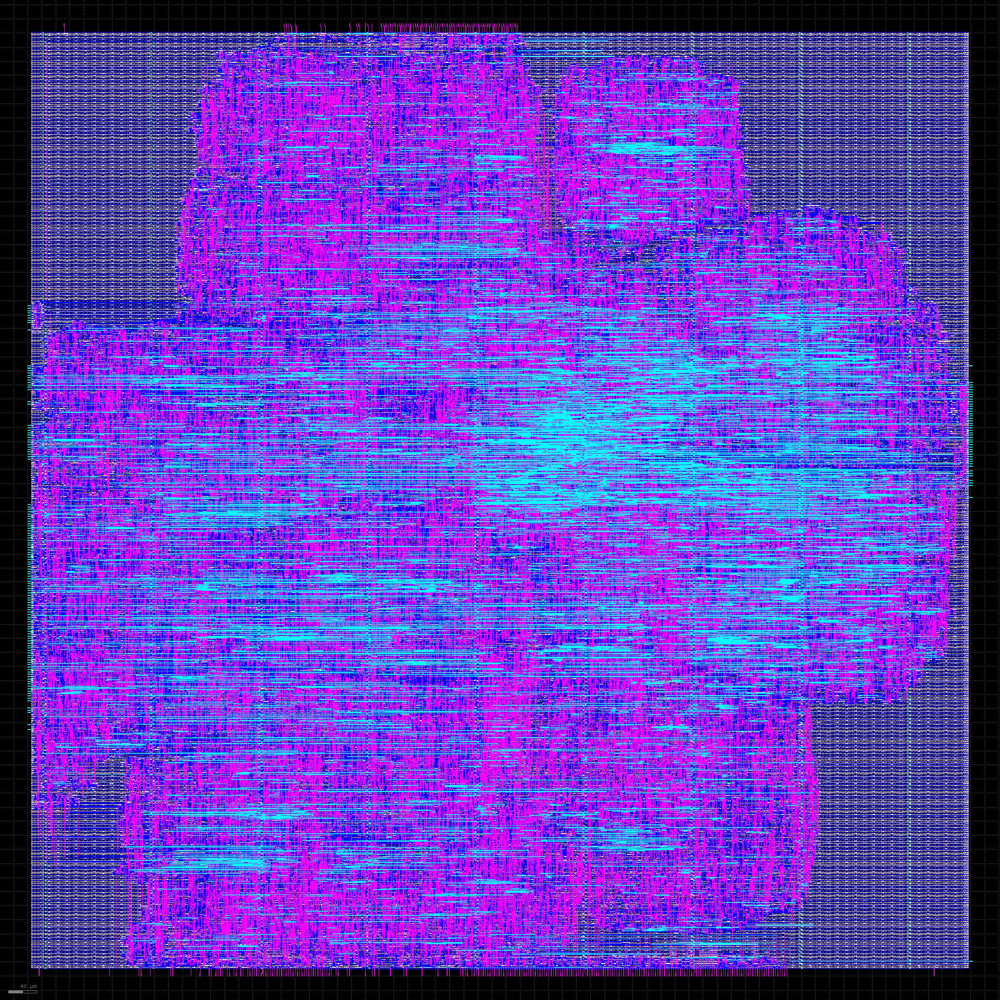

# Stage 6: the core as a Sky130 chip layout (OpenLane 2)

What gets built: `rtl/rv32im_asic.sv`, the core with 256-byte instruction and data caches (their
RAMs are flip-flops when `ASIC` is defined), the branch predictor, and one 16-byte line port to
outside memory. It's the same module that every cached lockstep test runs (`tb/tb_cached.sv`), so
the RTL going into the flow is already checked instruction by instruction against Spike.

## Result (run of 2026-11-11, OpenLane 2.3.10, Sky130A, `sky130_fd_sc_hd`)



*Signal routing (local interconnect and metal 1 to 3); the power grid on metal 4 and 5 is hidden.
`tools/layout_png.py` renders it from the final GDS.*

| | Result |
|---|---|
| Die / core area | 1.82 mm² / 1.77 mm² (cells: 0.81 mm², 45% utilization) |
| Instances | 95,916 |
| DRC (Magic, KLayout) | **0 / 0** |
| LVS | **0 errors** |
| Timing at 50 MHz, typical corner (25 °C, 1.8 V) | **+5.49 ns slack: Fmax 68.9 MHz** |
| Timing, fast corner (-40 °C, 1.95 V) | +10.54 ns: 105.7 MHz |
| Timing, slow corner (100 °C, 1.6 V) | **-7.81 ns: 36.0 MHz** (worst extraction corner -8.35 ns: 35.3 MHz). Does not meet 50 MHz here |
| Hold | met at every corner (worst +0.11 ns) |
| Gate-level simulation | **50 / 50 riscv-tests (rv32ui + rv32um) match Spike on the final netlist**: 24,360 instructions compared (Icarus Verilog, Sky130 cell models) |
| Power (OpenSTA, default switching activity) | 149 mW |
| Not clean yet | 153 antenna violations; max slew / max capacitance / max fanout warnings (e.g. 101 / 72 / 653 at the typical corner) |

All numbers are from `final/metrics.json` of that run (copied to
[results/asic_metrics_2026-11-11.json](results/asic_metrics_2026-11-11.json)); `tools/asic_report.py`
prints them.

What it means:
- **The layout passes the design-rule and layout-vs-netlist checks** (DRC, LVS). It isn't
  sign-off ready yet: the antenna violations (long wires that could damage
  transistor gates during manufacturing) need diodes, which OpenLane can insert
  (`DIODE_ON_PORTS`, `RUN_HEURISTIC_DIODE_INSERTION`); the slew/capacitance warnings are nets driven
  by cells too weak for their load, usually fixed by more buffering in the repair steps.
- **50 MHz holds at typical conditions but not at the slow corner.** The slowest Sky130 corner is
  about half the speed of the typical one. Meeting 50 MHz everywhere means either a longer clock
  target there or shortening the slowest paths.
- For comparison, the FPGA build with the same core meets 50 MHz on the DE10-Lite; in Sky130
  (130 nm) the typical corner reaches 68.9 MHz.

## How it was brought up (and three tool problems)

1. OpenLane's linter (an older Verilator) rejected the branch predictor's reset loop (non-blocking
   writes to an array inside a `for` loop). The counters and BTB valid bits became packed vectors,
   reset in one assignment.
2. OpenLane's SystemVerilog plugin (Synlig) crashed with an internal Yosys assertion. The flow now
   converts the design to plain Verilog with sv2v first (from nixpkgs).
3. Yosys couldn't read a two-dimensional unpacked array (`data_out[way][lane]` in the cache) in the
   converted code. The cache's arrays became packed arrays (indexed the same way).

After each change: the cached lockstep tests, the predictor tests, a Quartus build, and on the
board the SDRAM diagnostic and CoreMark from SDRAM (751,703,684 cycles, identical to before).

## Installing the tools (done once, in WSL Ubuntu)

1. **Nix.** Follow the "Nix-based installation" page of the OpenLane 2 documentation
   (openlane2.readthedocs.io). It installs Nix (asks for your password once) and adds OpenLane's
   binary cache, so the tools download ready-made instead of being compiled for hours. Close and
   reopen the terminal afterwards.
2. **OpenLane 2:**
   ```bash
   git clone https://github.com/efabless/openlane2 ~/openlane2
   ```
3. **Icarus Verilog** (for the gate-level simulation):
   ```bash
   sudo apt install iverilog
   ```

## Running it

From the repository root in WSL:
```bash
nix-shell ~/openlane2/shell.nix --run "bash asic/run_flow.sh"
python3 tools/asic_report.py
python -m pytest tests/core/test_gate_level.py
```
The first `nix-shell` downloads the tools and the Sky130 PDK (several GB). The flow itself
(synthesis, floorplan, placement, clock tree, routing, DRC, LVS, timing) takes a while for a design
this size. Results go to `asic/runs/<date>/final/`: the GDS layout, the netlists, and
`metrics.json`. A screenshot of the layout: open `final/gds/rv32im_asic.gds` in KLayout (part of the
same Nix shell: `klayout asic/runs/<date>/final/gds/rv32im_asic.gds`).

## What to expect and what to check

- **DRC and LVS clean**: `tools/asic_report.py` prints the error counts (Magic and KLayout DRC, LVS);
  all must be 0.
- **Timing**: the setup slack at the 20 ns target at each corner; Fmax follows from it.
- **Gate-level**: all 50 riscv-tests (rv32ui + rv32um) must match Spike on the final netlist.
