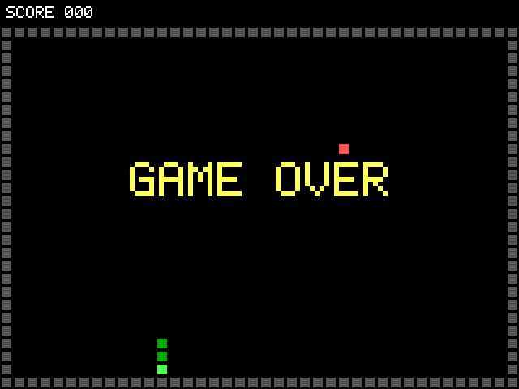

# Notes

Plain-English explanations of every part of this project, written to learn from and to
explain in interviews. Each stage adds a section.

## Stage 0: The tools and why each one is here

### Verilator
Verilator turns SystemVerilog into C++ and compiles it into a fast program that simulates the
design one clock cycle at a time. It only knows 0 and 1 (no X or Z), and it ignores `#` delays.
That makes it much faster than an event-driven simulator like Icarus, which is what makes running
thousands of instructions (riscv-tests, random tests, C programs, later CoreMark) practical.

### cocotb
cocotb lets you write testbenches in Python. The Python test drives the design's inputs and
checks its outputs while the simulator runs. Checking against a Python model (for example
`(a + b) & 0xFFFFFFFF` for the ALU) is quick to write and easy to read.

### RISC-V GCC
A cross compiler: it runs on the PC but produces RISC-V machine code. It compiles the tests and
the C programs into ELF files, which get turned into memory images that the simulated CPU runs.

### Spike
Spike is the official RISC-V reference simulator (the "golden model"). It runs the same program
as the CPU and says what should happen. With `--log-commits` it prints every instruction it
retires and every register and memory write it made.

### Lockstep comparison
The CPU reports the same information for every instruction it retires (PC, register written and
value, memory written and value). A script compares the two lists one instruction at a time and
stops at the first difference. This catches bugs the moment they happen, not hundreds of
instructions later when a test's final answer comes out wrong.

### Interview questions

**Why Verilator and not Icarus?**
Verilator compiles the design into a cycle-based C++ model, so it is much faster: important when
running full programs. The tradeoffs are that it is 2-state (no X propagation) and ignores timing
delays, so it is meant for synthesizable RTL, which is what a CPU is.

**What is a golden model and why do you need one?**
A trusted reference implementation of the spec. Without one you have to hand-write the expected
result of every test. With one, any program becomes a test: run it on both and compare.

**Why compare at every retired instruction, not just the final result?**
A wrong result might not show up until much later, or may never reach the final output. Comparing
at every retired instruction points to the exact instruction where the CPU went wrong.

## Stage 1, step 1: ALU, register file, decoder

These are the three building blocks every later stage uses. Each one is tested on its own
before it goes into the pipeline, because a bug is much easier to find in a 30-line module
than in a whole CPU.

### ALU (`rtl/alu.sv`)
The ALU is the calculator. It takes two 32-bit numbers `a` and `b` and an operation, and gives
one 32-bit result. It does the 10 RV32I operations: add, subtract, shift left, shift right
(logical and arithmetic), set-less-than (signed and unsigned), xor, or, and.

It is *combinational*: no clock, the output just follows the inputs. The pipeline decides
when to capture the result.

Things worth knowing:
- **Shifts use only the low 5 bits of `b`.** A 32-bit value can only shift 0–31 places, so
  the spec says to ignore the upper bits. Shifting by 32 is the same as shifting by 0.
- **SRL vs SRA.** Logical right shift fills with zeros; arithmetic right shift copies the sign
  bit, so a negative number stays negative (it divides by 2 and rounds down).
- **SLT vs SLTU.** The same bits compare differently: `0xFFFFFFFF` is -1 signed (less than 0)
  but the largest number unsigned.
- **There is no overflow flag.** RISC-V does not have condition flags; branches compare two
  registers directly.

**How it is tested:** every operation on every pair of 11 boundary values (0, 1, the largest
positive number, the most negative number, all ones, shift amounts 31 and 32, ...) and 20,000
random cases, all compared with a Python model.

### Register file (`rtl/regfile.sv`)
The 32 registers x0–x31, each 32 bits. Two read ports (an instruction can read two registers,
rs1 and rs2) and one write port (it writes at most one, rd).

- **x0 is always zero.** Writes to it are ignored. This gives the ISA a free zero:
  `mv a0, a1` is really `addi a0, a1, 0`, and `nop` is `addi x0, x0, 0`.
- **Reads are combinational, writes happen on the clock edge.**
- **Write-before-read.** If the instruction in WB is writing x5 in the same cycle that the
  instruction in ID reads x5, the read returns the *new* value. Without this, the pipeline would
  need one more forwarding path. This is the third of the three ways a value can reach a
  dependent instruction early (the other two are the forwarding paths in Stage 1, step 3).
- **No reset.** Real RISC-V cores don't clear their registers at reset; startup code sets the
  registers it needs. It also keeps the hardware smaller.

**How it is tested:** first every register is written with a known value, then 20,000 random
cycles of reads and writes (a quarter of reads hit the register being written, to exercise the
bypass) compared with a Python model, plus directed tests for x0 and write-before-read.

### Decoder (`rtl/decoder.sv`)
The decoder looks at the 32-bit instruction and works out what it means: which registers it
reads and writes, its immediate (the constant inside the instruction), and a set of control
signals that tell the later stages what to do (which ALU operation, whether to access memory,
whether it is a branch or jump, what to write back).

- **Instruction formats.** RISC-V has six layouts: R (register-register), I (immediate,
  including loads and JALR), S (stores), B (branches), U (LUI, AUIPC) and J (JAL).
  The register fields rs1, rs2 and rd are always in the same bit positions, so they can be read
  before the decoder even knows what the instruction is.
- **Why the immediate bits look scrambled.** In B and J formats the immediate's bits are
  shuffled around. That is on purpose: it keeps the sign bit always at bit 31 and puts as many
  bits as possible in the same place across formats, so the hardware needs fewer multiplexers.
- **B and J immediates have an implicit 0 at bit 0**, because instructions are at least 2 bytes
  aligned. That doubles the jump range for free.
- **`uses_rs1` / `uses_rs2`.** Every instruction has bits where rs1 and rs2 would be, even when
  it doesn't use them (LUI, JAL). The hazard unit will use these flags so it doesn't stall for a
  dependency that isn't real.
- **`reg_write` is off when rd is x0.** Writing x0 does nothing, so no forwarding or hazard logic
  should ever think a result is coming from x0.
- **Illegal instructions** come out with every side effect turned off and `illegal` set. Later,
  this lets the CPU stop safely instead of doing something random. The M-extension encodings
  are illegal until the multiply/divide step. FENCE is a no-op (an in-order core with one memory
  path already keeps loads and stores in order); FENCE.I is not supported, because the
  instruction and data memories are separate.

**How it is tested:** a Python encoder (written separately from the RTL) packs random field values
into instruction words for every RV32I instruction, and the decoder must unpack the same values:
20,000 random instructions, plus the largest and smallest immediate of every format. Then 40,000
random and mutated words check that the decoder flags exactly the illegal ones. A bug planted in
the branch immediate was caught by two of the three tests.

### Interview questions

**Why is x0 hardwired to zero?**
It gives a constant zero without spending an instruction, and lets many instructions double as
others: `nop`, `mv`, `j` (JAL with rd = x0), `beqz`, etc. are all just normal instructions using x0.
That keeps the base ISA small.

**Why does RISC-V scramble the immediate bits in branch and jump instructions?**
To keep the sign bit at bit 31 in every format and to keep bits in the same position across formats
wherever possible. Sign extension is then always from bit 31, and the immediate generator needs
fewer multiplexers. Hardware simplicity was chosen over encoding readability.

**What is write-before-read in a register file and why does a pipeline want it?**
When WB writes a register in the same cycle ID reads it, the read returns the new value. Without it,
an instruction three behind a producer would read a stale value, and the pipeline would need an extra
forwarding path or stall.

**What's the difference between SRA and SRL? Between SLT and SLTU?**
SRA fills with the sign bit (signed divide by a power of two, rounding down); SRL fills with zeros.
SLT compares as signed numbers, SLTU as unsigned. The bits are the same; only the interpretation
differs.

**Why does the decoder output `uses_rs1`/`uses_rs2` instead of letting the hazard unit just compare
register numbers?**
The rs1/rs2 bit fields always contain *something*, even for instructions like LUI and JAL that don't
read registers. Comparing them blindly would cause stalls for dependencies that don't exist.

**How do you know your tests can find bugs?**
I plant a bug on purpose (for example, take the wrong bit for the branch immediate) and check that
the test fails with a clear message, then restore the file. A test that has never failed might not
be checking anything.

## Stage 1, steps 2-4: the pipeline, branch flush, forwarding, load-use stall

### The pipeline (`rtl/core.sv`)
A pipeline works like an assembly line. Running one instruction takes five steps, and each step
has its own hardware, so while one instruction is being executed the next one is being decoded
and the one after that is being fetched. Up to five instructions are in flight at once. Each
one still takes five cycles, but one finishes every cycle.

| Stage | What happens |
|---|---|
| **IF** (fetch) | Send the PC to the instruction memory; the PC moves on to PC+4. |
| **ID** (decode) | The instruction arrives. Decode it and read rs1 and rs2 from the register file. |
| **EX** (execute) | The ALU computes. Branches compare and jumps compute their target. |
| **MEM** (memory) | Loads and stores send their address (and data) to the data memory. |
| **WB** (write back) | The loaded data arrives; write the result to rd. |

Between stages are **pipeline registers** (`d`, `e`, `m`, `w` in the code): on every clock edge
each instruction moves one stage forward, taking everything later stages will need with it.

**Valid bits and bubbles.** Each pipeline register has a `valid` bit. A slot with `valid = 0` is a
*bubble*: an empty slot that does nothing. Bubbles appear after reset, when instructions are
flushed, and when the pipeline stalls. Every action with an effect (writing a register, writing
memory, jumping) checks `valid` first.

**Synchronous-read memories.** FPGA block RAM (the MAX 10's M9K blocks) gives its read data one
clock *after* it gets the address. So IF sends the PC and the instruction shows up in ID, and MEM
sends the address and the loaded data shows up in WB. The memory's output register takes the
place of a pipeline register, so this costs no extra cycles compared to the textbook design.

### Control hazards: branch flush
The core doesn't know where a branch goes until EX. By then it has already fetched two more
instructions (now in IF and ID), assuming the branch is not taken ("predict not taken" is just
"keep fetching PC+4").
- **Not taken:** the guess was right; nothing is lost.
- **Taken, or any jump:** those two instructions are on the wrong path. They are **flushed**
  (turned into bubbles) and fetch restarts at the target. That costs 2 cycles: the
  **branch penalty**.

Stage 5 will add a branch predictor to guess taken branches and avoid most of that penalty.

### Data hazards: forwarding
`add x5, x1, x2` followed by `sub x6, x5, x3`: the `sub` reads x5 in ID while the `add` is still
in EX, and x5 is only written in WB, three cycles later. Without help, `sub` would read the old
x5.

But the value already exists: the `add` computed it in EX. **Forwarding** (also called bypassing)
sends it straight to the ALU input:
- 1 instruction later: the producer is in **MEM**, take its result from there.
- 2 instructions later: the producer is in **WB**, take the write-back value.
- 3 instructions later: the producer writes in WB in the same cycle the consumer reads in ID; the
  register file's **write-before-read** handles it.
- If two older instructions both write the register, the newer one (MEM) wins.

Forwarding works for anything that reads registers in EX: ALU operands, store address and data,
branch comparisons and the JALR base.

### Data hazards: the load-use stall
A load is different: its data only exists once the load reaches WB. If the very next instruction
needs it (`lw x5, 0(x10)` then `addi x6, x5, 1`), there is nothing to forward yet when `addi` is in
EX. So the core **stalls**: IF and ID hold their instructions for one cycle (the PC doesn't move,
and the instruction memory output is frozen) and a bubble goes into EX. One cycle later, `addi`
enters EX just as the load reaches WB, and WB forwarding supplies the value.

The stall only happens when it's really needed: the consumer must actually read the register
(`uses_rs1`/`uses_rs2` from the decoder) and the load must actually write one (not x0). A load
followed by an independent instruction costs nothing; compilers schedule code to make that the
common case.

### How it is tested: lockstep with Spike
Each program in `tests/asm/` runs twice: on Spike (the official RISC-V simulator) and on the core
in Verilator. Spike prints every instruction it retires (PC, instruction, register written and its
value, memory address and store data). The core reports the same through its `rvfi_*` retire
signals. The test compares the two lists one instruction at a time and stops at the first
difference, printing both sides.

The programs:
- `padded_alu.S`, `padded_mem.S`, `control_flow.S`: every RV32I instruction, written with NOPs
  between dependent instructions so they didn't need forwarding (written before it existed).
  `control_flow.S` puts a `j fail` right after every taken branch and jump, so a missing flush
  fails immediately.
- `forwarding.S`: back-to-back dependencies at distance 1, 2 and 3, on every kind of consumer.
- `load_use.S`: loads used immediately, by every kind of consumer, plus cases that must not stall.

Each program also checks its own results and reports pass/fail through `tohost`. Spike runs the
same checks, so a mistake in a test's expected value shows up as Spike failing, not as a fake
CPU bug.

Every hazard mechanism was switched off once on purpose to make sure its test catches it:
no flush (the core ran the wrong-path `j fail`), MEM forwarding replaced (a stale value at
instruction #2) and no load-use stall (a stale loaded value at instruction #4).

### Interview questions

**Walk me through your pipeline.**
Five stages: IF, ID, EX, MEM, WB, with pipeline registers between them carrying each instruction's
data and control signals. Branches resolve in EX with predict-not-taken and a 2-cycle penalty on
taken branches. Data hazards are handled by forwarding from MEM and WB plus write-before-read in
the register file, and the one case forwarding can't cover, a load followed by a use, stalls one
cycle.

**What are the three kinds of hazards?**
Structural (two instructions need the same hardware at once: avoided here with separate
instruction and data memories), data (an instruction needs a result that isn't written yet:
forwarding and the load-use stall) and control (the next PC isn't known until a branch resolves:
predict not taken and flush).

**Why can't you forward a load result the same way as an ALU result?**
The ALU result exists at the end of EX. The load result only exists after the memory access, at
the end of MEM (in WB with synchronous-read memory). An instruction right behind the load is
already in EX by then, so it has to wait one cycle.

**What's the branch penalty, and how would you reduce it?**
2 cycles for every taken branch or jump, because they resolve in EX. Ways to reduce it: resolve
branches in ID (needs a comparator and forwarding into ID, and lengthens that stage), predict
branches with a branch predictor and branch target buffer, or let the compiler lay out code so
the common path falls through.

**What's the difference between a stall and a flush?**
A stall holds instructions where they are (and inserts a bubble behind them) because they can't
proceed yet; nothing is thrown away. A flush throws away instructions that should never have
been fetched by turning them into bubbles.

**Why give every pipeline register a valid bit instead of turning bubbles into NOPs?**
A valid bit is one flop and one AND gate per side effect, and it's unambiguous: a bubble can never
be confused with a real instruction (an actual `nop` in the program retires and shows up in the
trace; a bubble doesn't).

**How did you verify the pipeline?**
Lockstep comparison against Spike at every retired instruction, on directed test programs for
each hazard type. I also disabled each hazard mechanism on purpose to confirm the tests catch it.

## Stage 1, step 6: the official riscv-tests

[riscv-tests](https://github.com/riscv-software-src/riscv-tests) is the RISC-V project's own set
of instruction tests. The `rv32ui` suite ("RV32, user-level, integer") has one test per base
instruction, each with dozens of cases: edge values, every register used as source and
destination, and back-to-back dependencies at different distances (the "bypass" cases), which
test forwarding again from a different angle.

**The environment file.** Each test includes `riscv_test.h`, which says how a test starts and
how it reports pass/fail. The official version sets up machine-mode CSRs and trap handlers and
ends with ECALL, which this core doesn't have yet. So `tests/env/riscv_test.h` is a minimal
replacement: clear all registers, run the test, write the result to `tohost` (1 = pass,
(test number << 1) | 1 = fail). Writing your own environment is the normal way to bring up the
suite on a new core.

**How they run.** Each test runs in lockstep with Spike, like the hand-written programs: every
retired instruction must match, not just the final pass/fail.

**Result** (`make test`): 40 of 42 rv32ui tests pass, comparing 13,107 instructions against
Spike. Two are excluded, with the reason printed in the test output:
- `fence_i`: the test rewrites its own code and runs it. With separate instruction and data
  memories, the instruction side never sees the new code. Supporting it needs FENCE.I to
  flush/reload instruction memory (or a cache), which comes later.
- `ma_data`: misaligned loads and stores (e.g. a word at an address that isn't a multiple of
  4). The spec allows a core to either handle them in hardware or trap and handle them in
  software; this core does neither yet.

A planted bug (SRA behaving like SRL) failed the `sra`, `srai` and `lui` tests.

### Interview questions

**How did you know your CPU implements the ISA correctly?**
Three layers: unit tests of the ALU, register file and decoder against Python models; the
official riscv-tests rv32ui suite; and lockstep comparison against Spike on every retired
instruction of every test, so a bug is caught at the exact instruction where it happens.

**What is a misaligned access and what does RISC-V say about it?**
An access whose address isn't a multiple of its size, like a 4-byte load from address 0x1002.
RISC-V lets the implementation choose: handle it in hardware, or raise an exception so software
can emulate it. Simple cores usually trap, because handling it in hardware means splitting one
access into two.

**Why does FENCE.I exist?**
A core can have separate paths (or caches) for instructions and data. When a program writes
new code with stores (a JIT, a bootloader), FENCE.I tells the core to make those stores visible
to instruction fetch before running the new code.

## Stage 1, step 8: random instruction tests

Directed tests only check the cases someone thought of. Random tests find the ones nobody
thought of: odd combinations of hazards, registers and values.

`tests/core/random_program.py` writes random RV32I programs. Each one:
- starts with every register holding a random value (with extra weight on edge values like
  0x80000000 and 0xFFFFFFFF), and a 256-byte data buffer full of random data;
- runs 400 random items: ALU ops, loads and stores of every size inside the buffer, forward
  branches and jumps (JAL, and JALR through a computed address), LUI/AUIPC, FENCE, and small
  counted loops (backward branches);
- uses a small "hot" set of 4 registers 60% of the time, so instructions constantly depend on
  the one just before: forwarding and load-use stalls happen all the time.

There are no expected values in the program. The oracle is Spike: every retired instruction must
match in lockstep. Jumps only go forward (and loops have a counter), so every program ends.

Seeds are fixed (0, 1, 2, ...) so any failure can be reproduced exactly. CI runs 20 programs on
every push; `RANDOM_PROGRAMS=300 make test` runs more.

**Results** (actual runs): 20 programs = 9,296 instructions compared in CI; a 300-program run
compared 140,187 instructions with zero mismatches. A planted bug (no load-use stall when only rs2
depends on the load) failed 14 of the 20 CI programs.

### Interview questions

**Directed tests or random tests?**
Both. Directed tests prove the features you know about and give clear failures; random tests
explore combinations you didn't think of. Constrained-random is the standard in industry DV: random
within rules that keep the program legal (aligned addresses inside the buffer, forward-only jumps,
bounded loops).

**What is the "oracle" in your random tests?**
Spike, the reference model. Random programs have no hand-written expected values; correctness means
every retired instruction matches Spike.

**How do you reproduce a failing random test?**
Every program comes from a fixed seed, so rerunning that seed regenerates exactly the same program.

## Stage 1, step 9: the M extension (multiply and divide)

The M extension adds 8 instructions:
- **MUL**: low 32 bits of rs1 × rs2 (the same for signed and unsigned).
- **MULH / MULHSU / MULHU**: the high 32 bits of the 64-bit product, treating the operands as
  signed×signed, signed×unsigned, or unsigned×unsigned.
- **DIV / DIVU**: quotient, rounded toward zero. **REM / REMU**: remainder; its sign follows the
  dividend, so `dividend = divisor × quotient + remainder` always holds.

**No exceptions for division.** RISC-V never traps on divide. Dividing by zero gives a quotient
of all ones (-1) and a remainder equal to the dividend; the one signed overflow case,
-2^31 / -1, gives -2^31 with remainder 0. The hardware handles both without any special path.

### The multiply/divide unit (`rtl/muldiv.sv`)
It is a separate unit next to the ALU, because multiply and divide are much bigger and slower than
an add. It takes several cycles, and the pipeline waits for it:

- **Multiply: 2 extra cycles.** The operands are first copied into registers, then a 33×33-bit
  signed multiplier computes the product into the result register. Extending each operand to 33
  bits (with its sign bit for signed operands, a 0 for unsigned) lets one signed multiplier do
  all four MUL variants. Having registers on both sides gives the multiplier a full clock cycle,
  which matters on the FPGA, where it maps onto the hardware multiplier (DSP) blocks.
- **Divide: 33 extra cycles.** *Restoring division*, the long division from school in binary:
  each cycle shifts one more bit of the dividend into the remainder, and if the divisor fits it is
  subtracted and the quotient bit is 1. 32 bits take 32 cycles. Signed division divides the
  magnitudes and fixes the signs at the end.

Measured on the core: 64 independent instructions took 80 cycles for ADD, 208 for MUL and 2,192
for DIVU (the same program otherwise), so (208 − 80) / 64 = **2 extra cycles per MUL** and
(2192 − 80) / 64 = **33 extra cycles per DIVU**.

### How the pipeline waits: the EX stall
When an M instruction is in EX and the unit isn't done, the core **stalls EX**: the instruction
stays in EX, IF and ID hold too, and bubbles go into MEM (so instructions already ahead keep
going and retire). When the unit says `done`, the result goes into the EX/MEM register like an
ALU result, and from there forwarding works exactly as for any other instruction.

The unit copies its operands when it starts, so they are the correct forwarded values at that
moment, even though the instructions they were forwarded from move on.

### Tradeoffs worth knowing
- **Faster multiply:** a single-cycle multiplier needs no stall but makes EX slower, which lowers
  the clock for every instruction. A pipelined multiplier (several stages, a new multiply every
  cycle) is what high-performance cores use; it adds forwarding/hazard cases.
- **Faster divide:** radix-4 or SRT dividers produce 2+ bits per cycle at more area. Division is
  rare in most code (compilers turn division by constants into multiplies), so a slow, small
  divider is a common choice for small cores.
- **Not blocking the pipeline:** an out-of-order core keeps running independent instructions while
  a divide is in progress. This in-order core simply waits.

**Results** (`make test`): all 8 official rv32um tests pass in lockstep with Spike (2,181
instructions); a directed `muldiv.S` covers forwarding into and out of the unit, back-to-back M
instructions, a load-use stall into a multiply, and branches right after a divide; the random
programs now include M instructions (a 300-program run compared 140,887 instructions, 6,667 of
them multiply/divide, with no mismatch). The unit's own tests check every operation on all pairs
of 10 edge values plus 3,000 random cases. A planted bug (remainder sign not fixed) failed the
official `rem` test.

### Interview questions

**Why is divide so much slower than multiply?**
A multiply's partial products are all known up front and can be added in parallel (a tree of
adders, or the FPGA's DSP blocks). Division is sequential: each quotient bit depends on the
remainder left by the previous step.

**What does RISC-V do on division by zero?**
No trap: the quotient is all ones and the remainder is the dividend. That keeps the hardware
simple; software that cares checks the divisor first.

**How did you implement MULHSU with one multiplier?**
Extend both operands to 33 bits, the signed one with its sign bit and the unsigned one with a 0,
then do one 33×33 signed multiply. The extra bit makes an unsigned 32-bit value a non-negative
signed number.

**What happens to the pipeline during a 33-cycle divide?**
The divide stays in EX; IF and ID hold, and bubbles go into MEM, so older instructions finish. When
the unit is done, the divide moves on and the pipeline continues.

## Stage 1, step 10: running C programs

**Startup code (`sw/crt0.S`).** C code expects a few things to be true before `main` runs.
`crt0` ("C runtime zero") sets them up:
1. Clear all registers (so the core and Spike start from the same state).
2. Set the stack pointer to the end of RAM; the stack grows down from there.
3. Zero the `.bss` section: C promises that global variables with no initial value start at 0.
4. Call `main`, then report its return value through `tohost` (0 = pass).

**Linker script (`sw/link.ld`).** Tells the linker where everything goes in memory: code first at
0x80000000 (where the core starts after reset), then the `tohost` word, then initialized data,
then `.bss`, and marks where the stack starts (`_stack_top`).

**No C library.** The programs are built with `-nostdlib -ffreestanding`: there's no `printf` or
`malloc` yet (Stage 2 adds a UART for printing). Each program checks its own results and returns 0
or an error code.

**The programs** (`sw/programs/`), each run in lockstep with Spike:
- `fib.c`: recursive and iterative Fibonacci (lots of calls, returns and stack traffic).
- `sort.c`: quicksort of 256 pseudo-random numbers, then a check that the output is sorted and is a
  permutation of the input.
- `primes.c`: counts the primes below 2000 by trial division, so it divides a lot.

**Results** (from `make test`):

| Program | Instructions | Cycles | CPI |
|---|---|---|---|
| fib | 176,516 | 203,389 | 1.152 |
| sort | 29,513 | 38,312 | 1.298 |
| primes | 72,250 | 504,092 | 6.977 |

**CPI** (cycles per instruction) is 1 for a perfect pipeline. Each taken branch or jump adds 2,
each load-use stall 1, each multiply 2, each divide 33. `fib` and `sort` are close to 1; `primes`
is near 7 because almost every inner-loop iteration runs a 33-cycle divide.

### Interview questions

**What does crt0 do, and why can't main just start at the reset address?**
C code assumes a valid stack pointer and zeroed `.bss`. The hardware gives neither at reset, so a
small piece of assembly sets them up and then calls `main`.

**What's in a linker script?**
The memory regions and where each section (`.text`, `.data`, `.bss`, the stack) is placed in them,
plus symbols the startup code uses (`_bss_start`, `_bss_end`, `_stack_top`).

**Your primes program has a CPI of about 7. What would you do about it?**
The cost is the 33-cycle divider. Options: a faster divider (radix-4 or SRT, 2+ bits per cycle);
let independent instructions continue while the divider runs (needs a scoreboard to stall only
real dependents); or change the software: a sieve instead of trial division avoids division
entirely.

## Stage 2, step 1: wait states on the data port

In Stage 1 every data access took exactly one cycle (address in MEM, data in WB). In the SoC,
some devices are slower: a bus peripheral needs a few cycles, and SDRAM needs many. So the core
gets a **wait-state input**, `dmem_stall`: "the instruction in WB is still waiting for its
data."

**What the core does: freeze.** While `dmem_stall` is high, *every* pipeline register holds,
the PC holds, nothing is written to the register file, and nothing retires. When the data
arrives, everything moves on together. It's the simplest correct answer for an in-order core:
the instruction that's waiting is the oldest one, so nothing behind it can finish first anyway.

Details that matter:
- **A request is sent only once.** The core only sends a data request in the cycle its
  instruction actually leaves MEM (`dmem_en` is off while frozen), so a store is never issued
  twice and the memory's output register isn't overwritten while WB waits for it.
- **The multiply/divide unit keeps its result while frozen.** It stays in its DONE state until
  the core has really taken the result, and it doesn't start while frozen (its operands might be
  forwarded from the load that's still waiting).
- **Freeze beats flush.** A taken branch in EX during a freeze is applied when the freeze ends,
  not during it.

**How it's tested.** The testbench can add random wait states (`+random_stalls`): every data
access gets a random number of extra cycles from an LFSR. All directed programs, all
riscv-tests, the C programs and 10 random programs run again this way, in lockstep with Spike.
They all pass, and the slowdown shows the stalls really happened (sort: 38,312 → 44,377 cycles;
fib: 203,389 → 243,247). Removing the freeze from the EX pipeline register made 26 of these
tests fail.

### Interview questions

**How does your pipeline handle a memory access that takes several cycles?**
The memory signals a stall while the instruction in WB waits for its data, and the whole
pipeline freezes: every pipeline register and the PC hold, nothing writes back, and requests
aren't re-sent. When the data arrives, everything advances together.

**Why not just stall the stages behind WB?**
In an in-order pipeline the waiting instruction is the oldest; everything behind it must stay in
order anyway, so freezing all stages is simple and costs nothing extra. Out-of-order cores let
independent later instructions continue, at a big cost in complexity.

**How did you verify the stall logic?**
By injecting random wait states into every data access and rerunning all the lockstep tests:
correct results with random timing means the stall logic works at any timing, not just the cases
I thought of.

## Stage 2: one RAM for code and data, and FENCE.I

In Stage 1 the testbench had separate instruction and data memories, so the official `fence_i`
test (which writes new code and then runs it) had to be excluded. The SoC design puts code and
data in **one dual-port RAM** (`rtl/dpram.sv`): port A for fetch, port B for loads and stores,
the same shape as an FPGA block RAM in true dual-port mode. A store through port B is visible to
fetch through port A.

That leaves one problem: instructions already fetched before the store finished. **FENCE.I** now
handles it: in EX it redirects to the next instruction, like a jump to PC+4, which flushes the 2
younger instructions and fetches them again from memory.

Testing: the official `fence_i` test passes now, but it would pass even without the flush: its
new code runs long after the store, and this pipeline only fetches 2 instructions ahead.
`tests/asm/fence_i.S` overwrites the instruction *right after* the FENCE.I; it passes with the
flush and fails without it.

rv32ui is now **41 of 42**; only `ma_data` (misaligned accesses) is excluded.

**Interview question: why does FENCE.I exist if your test passed without it?**
Because correctness can't depend on the pipeline's depth. A deeper pipeline, a prefetch buffer or
an instruction cache holds more old instructions; FENCE.I is the contract that says "after this,
fetch sees all earlier stores", whatever the microarchitecture.

## Stage 2, steps 2-3: the bus, the peripherals and the SoC

### Memory-mapped I/O
The CPU has no special I/O instructions. Each peripheral owns a range of addresses, and its
registers are read and written with ordinary loads and stores. Writing a byte to
`0x1000_0000` sends it out of the UART; reading `0x1000_2004` returns the switch positions.
In C this is a `volatile` pointer (`sw/lib/soc.h`): `volatile` tells the compiler every access
really has to happen, in order, because the "memory" has side effects.

### Wishbone
Wishbone is a simple, open on-chip bus standard (common on OpenCores and in open RISC-V SoCs).
A master starts a transfer by raising `stb` (strobe) with the address, write enable, byte
selects (`sel`) and write data; the slave answers with `ack` when the transfer is done, along with
read data. The master holds everything steady until `ack`. Because a slave can take as long as it
needs before acking, the bus handles slow and fast devices the same way.

Simplifications in this design: one master (the core), so `cyc` (bus ownership) is folded into
`stb`; and every peripheral acks one cycle after it's selected.

**The bridge** (`rtl/soc.sv`): when a load or store to a bus address leaves MEM, the bridge
captures it and drives it on the bus while the instruction waits in WB, freezing the core
(`dmem_stall`) until the ack. The **interconnect** decodes the address to pick the slave and
routes back that slave's ack and read data. Unmapped addresses get an ack with 0 from a default
slave, so a bad pointer can't hang the CPU.

### Tightly coupled memory
The boot ROM and on-chip RAM are *not* on the bus: they connect to the core directly, with
single-cycle access and no wait states (ARM calls this TCM). Only slow or rarely used devices go
on the bus. That's why the Stage 1 CPI numbers still hold for code running from RAM, while each
peripheral access costs 1 extra cycle.

### The peripherals
- **UART** (`rtl/wb_uart.sv`): serial port, 8 data bits, no parity, 1 stop bit. Transmitting
  shifts out a start bit (0), 8 data bits LSB first and a stop bit (1), each held for `divisor`
  clock cycles (434 at 50 MHz for 115200 baud). Receiving: the input first goes through two
  flip-flops (a **synchronizer**, because it comes from outside this clock domain and could
  otherwise cause metastability), then on a falling edge the receiver waits half a bit to reach
  the middle of the start bit and samples every bit in its middle, where it's most stable. A low
  glitch shorter than half a bit is rejected. If a byte arrives before the last one was read,
  the overrun flag is set.
- **Timer** (`rtl/wb_timer.sv`): a 64-bit cycle counter (it would take ~11,700 years to wrap at
  50 MHz) and a compare register. Software reads it as high, low, high again, and retries if the
  high half changed, because the low half may have wrapped between the two reads.
- **GPIO** (`rtl/wb_gpio.sv`): LEDs, switches, push buttons and the six 7-segment displays. The
  board's buttons and displays are active-low; the GPIO inverts them, so software always uses
  1 = pressed / lit. Switches and buttons also go through synchronizers.

### Software
`sw/lib/`: a driver per peripheral (`uart.c`, `timer.c`, `gpio.c`) and a small `printf`
(`%c %s %d %u %x %X %p %%`, zero padding and widths). `uart_putc` turns `\n` into `\r\n`,
because terminals expect a carriage return before the line feed.

**Result** (`tests/soc/test_soc.py`): the whole SoC in simulation, booting from ROM, jumping to a
C program in RAM, which prints over the UART (decoded back into text by the testbench), reads the
switches, and drives the LEDs and 7-segment displays. Output:

```
Hello from rv32im-core!
fib(30) = 832040, 230 cycles
switches = 0x155
printf check: [  -42] [  7] [0000beef] [ok] [Z] [%]
DONE
```

### Interview questions

**What is memory-mapped I/O, and why does the C code use `volatile`?**
Device registers appear at memory addresses and are accessed with normal loads and stores.
`volatile` stops the compiler from removing, merging or reordering those accesses, which it
would otherwise do for ordinary memory.

**Why do the UART input and the switches go through two flip-flops?**
They change at any time, not in step with the clock. A flip-flop sampling a signal as it changes
can go metastable (neither 0 nor 1 for a while). A second flip-flop gives it a full cycle to
settle, making a failure extremely unlikely. That's a two-flop synchronizer.

**Why sample UART bits in the middle?**
The sender's and receiver's clocks aren't exactly the same frequency, so the receiver's idea of
the bit boundaries drifts over the 10 bits of a frame. Sampling in the middle leaves the most room
for that drift and for noise around the edges.

**How does a 32-bit CPU read a 64-bit timer safely?**
Read the high word, the low word, then the high word again. If the two high reads differ, the
low word wrapped in between; read again.

**Why are RAM and ROM not on the Wishbone bus?**
Every instruction fetch and most loads and stores use them, so they need single-cycle access.
The bus adds at least one cycle per access; that's fine for a UART but not for main memory.

## Stage 2, step 4: the SDRAM controller

The board has a 64 MB SDRAM chip (IS42S16320: 4 banks × 8192 rows × 1024 columns × 16 bits).
SDRAM is cheap and dense, but much more complicated to use than on-chip RAM:

- **Rows and banks.** Data is in rows. To read or write, a row must first be **opened**
  (ACTIVE command, which copies the row into the bank's row buffer), then accessed with READ or
  WRITE (by column), then **closed** (PRECHARGE) before another row in that bank can be opened.
- **Timing rules.** Each step needs a minimum time before the next: open → access (tRCD,
  15 ns), close → reopen (tRP, 15 ns), open → open again (tRC, 60 ns), last write → close (write
  recovery), and so on.
- **CAS latency.** Read data comes back 2 clock cycles after the READ command (configurable).
- **Refresh.** The bits are tiny capacitors that leak. Every row must be refreshed every 64 ms:
  8192 rows means one REFRESH command at least every 7.8 µs, even when nobody uses the memory.
- **Power-up sequence.** Wait 100 µs, precharge all banks, at least 2 refreshes, then program
  the mode register (burst length, CAS latency).

### The controller (`rtl/sdram_ctrl.sv`)
A state machine behind a Wishbone interface. Design choices:
- **One 32-bit word = a burst of 2.** The chip is 16 bits wide, so the mode register sets burst
  length 2: one READ or WRITE command moves two halfwords on consecutive cycles. The byte masks
  (DQM pins) handle byte and halfword stores.
- **Closed page.** Every access opens its row, reads or writes with auto-precharge (the chip
  closes the row by itself after the burst), and waits out the recovery time. That's the simplest
  correct policy. "Open page" (leave the row open, and skip ACTIVE when the next access hits the
  same row) is faster for sequential accesses and is a natural Stage 5 experiment.
- **Refresh** is triggered by a counter every 380 cycles (7.6 µs at 50 MHz) and done between
  accesses.
- **Address mapping:** bits [10:2] column, [12:11] bank, [25:13] row, so consecutive words share a
  row.

### The chip model (`tb/sdram_model.sv`)
A testbench-only model of the chip that stores data and **checks every rule**: power-up wait,
init order, opening an already-open bank, accessing a closed bank, tRCD, tRAS, tRC, tRP, write
recovery, tRFC, tMRD, the refresh interval, and bus fights on the data pins. Each broken rule
prints a message and counts as a violation; tests require zero.

On its first run it found a real hardware bug: before reset takes effect, the controller's
command register is all zeros, and all-zeros is the LOAD MODE command. On the board that would
have sent a garbage mode-register write at power-up. Fix: the register gets a power-up value of
NOP (FPGA registers take initial values when the device is configured).

Two planted bugs were caught: a refresh interval too long (450 cycles, the model flags every
interval over 391) and sampling read data one cycle too early (wrong data).

### Results
- Unit test against the model: 3,000 random reads/writes with random byte masks across the
  whole 64 MB, 69 refreshes, 0 violations; and 1 ms idle with the controller refreshing on its own.
- From the CPU, in the SoC simulation (`sw/soc/sdram_test.c`): address-line test, random words,
  bytes and halfwords, and a timed copy: **256 words took 2,855 cycles to write and 3,615 to read**
  (about 11 and 14 cycles per word including the loop; on-chip RAM is about 1). 109 refreshes,
  0 violations.

**Not checked in simulation, to verify on the board:** the real chip needs its clock shifted
relative to the controller's (a PLL output with a phase offset), and the exact cycle to sample
read data depends on board delays (`READ_LATENCY`). Those are board bring-up items.

### Interview questions

**Why does SDRAM need refresh?**
Each bit is a charge on a tiny capacitor, which leaks. Reading a row and writing it back
(refresh) restores the charge; every row must be refreshed within 64 ms.

**What's the difference between open-page and closed-page policies?**
Closed page precharges after every access: each access pays ACTIVE + access + precharge, but
never pays to close someone else's row. Open page leaves the row open, so a following access to
the same row skips ACTIVE (a row hit), but a different row first needs a precharge (a row miss).
Open page wins for sequential/local accesses.

**What is CAS latency?**
The number of clock cycles between a READ command and the first data on the pins.

**How did you verify the controller without the board?**
Against a model of the chip that implements the datasheet's rules and counts violations, with
random traffic and long idle periods, then end to end from C code on the CPU. Planted bugs
(refresh too slow, sampling too early) were caught.

## Stage 2, step 5: the UART bootloader

Without a bootloader, running a new program means putting it into the FPGA's memory
initialization and rebuilding the whole FPGA image (minutes in Quartus). The bootloader lives in
the boot ROM, so it's the first thing that runs after reset. It waits for a program over the
serial port, stores it in on-chip RAM, checks it, and jumps to it.

**Protocol** (`sw/boot/bootloader.c`, host side `tools/upload.py`), numbers little-endian:
1. The board prints `ready`.
2. The host sends `BOOT`, the program's length (4 bytes), the program bytes, and a CRC-32 of the
   program (4 bytes).
3. The board answers `OK` and runs the program, or `ERR size` / `ERR crc` and waits again.
4. Sending just `R` reruns the program already in RAM (after pressing reset).

Details worth knowing:
- **CRC-32** (the same as zlib, Ethernet and PNG) catches corrupted bytes much better than a
  simple sum. It's computed after all bytes arrived, so the receive loop stays tiny: the UART
  holds only one byte, and a slow loop would drop bytes (overrun).
- **FENCE.I before jumping:** the program was written with stores, so fetch must be told to see
  them (see the FENCE.I section).
- **Memory layout:** the bootloader's code is in ROM; its variables and stack are at the top of
  RAM (from `0x8000_C000`), so programs up to 48 KB can be loaded at `0x8000_0000` without
  overwriting the bootloader while it runs.
- **Size: 996 bytes** of the 8 KB ROM.

**Test** (`tests/soc/test_soc.py::bootloader`): the real boot ROM in the SoC simulation. The test
waits for `ready`, sends a copy of the hello program with one byte flipped (the board must answer
`ERR crc` and become ready again), then the correct 2,708-byte program, which must run and print
its output.

`make sw` builds `build/sw/bootrom.hex` (the boot ROM image for Quartus) and a `.bin` of every
program in `sw/soc/` to send with `tools/upload.py`.

### Interview questions

**Why a bootloader instead of rebuilding the FPGA image?**
Rebuilding takes minutes; uploading over the UART takes about a quarter second for a small program.
It's also how real systems work: a small fixed boot ROM loads the real program from somewhere else
(flash, network, serial).

**Why CRC instead of a checksum?**
A sum misses errors that cancel out (one byte +1, another −1) or reordered bytes. A CRC detects all
single-bit errors, all burst errors up to 32 bits, and almost everything else.

**What happens if the bootloader is too slow to read a byte before the next arrives?**
The UART holds one received byte; the next one overwrites it and sets the overrun flag. That's why
the receive loop does nothing but read and store, and the CRC is computed afterwards.

## Stage 2, step 6: building for the FPGA

`fpga/de10lite/` is the Quartus project: a top level (`de10lite_top.sv`) that connects the SoC to
the board's pins, the pin assignments (copied from `edge-ml-accelerator/boardtest`, which ran on
this board), timing constraints, and the SDRAM clocking scheme from that same tested design
(SDRAM clock = inverted system clock; read data sampled 60 ns after READ, in the middle of the
50-70 ns window that was clean on this board).

### What the first real compile found (none of it visible in simulation)
1. **Quartus Lite accepts less SystemVerilog than Verilator.** The `inside` operator, size casts
   like `16'(x)`, and a struct field named like a module (`muldiv`) were rejected. Rewritten in
   forms both tools accept.
2. **The register file was about to be deleted.** Its reads went through a function, and Quartus
   decided the registers were "never read". Rewritten with plain `always_comb` reads.
3. **The memories weren't block RAM.** First Quartus tried to build 72 KB out of flip-flops (it
   would never fit, and synthesis ran for 40+ minutes); then, after a rewrite, it built each
   dual-port memory **twice** (one copy per read port). Fixed by instantiating Intel's block-RAM
   primitive (`altsyncram`, true dual-port, byte enables) for the FPGA build, with the simple
   behavioural model kept for simulation. The boot ROM's contents go in as a `.mif` file
   (`make sw`).
4. **Timing was barely met** (+0.012 ns of slack at 50 MHz): the slowest path went from the bus
   address, through the decoder that picks the peripheral, the acknowledge, and the pipeline
   freeze, into the PC. Decoding the peripheral when the request is captured (and keeping it in a
   register) took the decoder off that path.

### Results (Quartus Prime Lite 25.1, 10M50DAF484C7G)

| Resource | Used | Available | |
|---|---|---|---|
| Logic elements | 4,626 | 49,760 | 9 % |
| Registers | 2,167 | | |
| Memory bits | 589,824 | 1,677,312 | 35 % |
| 9-bit hardware multipliers | 8 | 288 | 3 % |

Timing at 50 MHz, worst case (slow silicon, 85 °C): **setup slack +1.875 ns, hold slack
+0.286 ns, Fmax 55.17 MHz**. The slowest path is now inside the core: data-memory read → load
extend → forwarding → EX.

**For Stage 4:** the 16x16 systolic array used about 62% of the logic on its own. The SoC uses 9%,
so the two together should fit in logic. Memory (35% used) and multipliers (3% used) also leave
room, but the VGA framebuffer in Stage 3 will take some of the memory. The real check is a
combined Quartus fit, early in Stage 4.

**Not covered by simulation:** the FPGA build uses `altsyncram`, while Verilator simulates the
behavioural model of the same memory. If the board doesn't print the bootloader banner, that
difference is a suspect (Questa, installed with Quartus, can simulate the real primitive).

### Interview questions

**Why didn't your simulations catch these problems?**
Simulation checks behaviour, not how a synthesis tool maps the code onto the chip. Language
support, memory inference and timing are synthesis questions, which is why you compile for the
real target early and read the reports, not just whether it compiled.

**What is RAM inference, and why didn't it work?**
Synthesis tools recognize certain coding patterns as memories and map them onto block RAM. If the
code doesn't match a pattern the tool knows (here: a dual-port memory with one read-only port and
byte-enabled writes on the other), it either builds the memory from flip-flops or splits it.
Instantiating the vendor's primitive removes the guesswork, at the cost of vendor-specific code.

**How did you fix your critical path?**
The timing report showed the slowest path started at the bus address and went through the slave
decoder in the same cycle as the acknowledge. I moved the decode to the cycle the request is
captured and registered it, which removed that logic from the path: slack went from +0.012 ns to
+1.875 ns.

## Stage 3: graphics

### How VGA works
A VGA monitor draws the picture one line at a time, left to right, top to bottom, 60 times a
second. The signal is just five wires: red, green and blue (analog levels; the DE10-Lite turns 4
bits per colour into a voltage with resistors) and two sync pulses:
- **HSYNC** marks the end of every line. A 640x480 line is 800 pixel times: 640 visible, then a
  16-pixel "front porch", a 96-pixel sync pulse, and a 48-pixel "back porch".
- **VSYNC** marks the end of every frame: 525 lines, 480 visible, then 10 + 2 (sync) + 33.

The porches and blank lines are left over from CRT monitors, which needed time to move the beam
back. The pixel rate is 25 MHz (one pixel every 2 clocks at 50 MHz), giving 59.5 frames per second;
monitors accept it.

### The framebuffer (`rtl/wb_vga.sv`, `rtl/fb_ram.sv`)
The picture lives in a **framebuffer**: one memory location per pixel. The display reads it
continuously, in step with the beam; the CPU writes it to change the picture.
- **320x240, each pixel shown as a 2x2 block** on the 640x480 screen: a quarter of the memory.
- **4 bits per pixel = 16 colours**, through a **palette**: the 4-bit value picks one of 16
  programmable 12-bit colours. A palette costs 16 registers instead of 8 more bits per pixel.
- **Dual-port block RAM:** the display reads one port, the CPU writes the other, so they never wait
  for each other. 76,800 pixels × 4 bits = 38 M9K blocks. (Why on-chip and not SDRAM: see the
  Stage 3 table in the roadmap.)
- **Registered output, one pixel late:** the RAM needs a clock to return the pixel, so the sync
  signals are delayed by the same amount to stay lined up with the colours.
- **Vertical blank status:** drawing while the beam is in the blank lines (`gfx_wait_vblank`)
  avoids "tearing" (half of the old picture and half of the new one on screen).

### Testing without a monitor (`tb/vga_capture.sv`)
A simulated monitor watches the five VGA signals. Like a real one, it finds lines and frames only
from the sync pulses, checks every timing number (line length 1,600 clocks, HS pulse 192 clocks,
525 lines per frame, VS pulse 2 lines) and saves each frame as an image. The unit test writes
pixels and a palette colour over the bus and checks the saved picture pixel by pixel (each pixel
must be a 2x2 block of the right colour). Two of its first findings: the VGA outputs had no reset
(a fake sync pulse at power-up), and the frame numbering was off by one.


### Software: `sw/lib/gfx.c` and Snake (`sw/soc/snake.c`)
The driver draws pixels, filled rectangles and text with a 5x7 font (scalable), sets palette
colours and waits for vertical blank. Snake uses a 40x30 grid of 8x8 cells, a ring buffer for
the snake's body, the timer for the game speed, KEY0/KEY1 (turn right/left) or W/A/S/D over the
UART, and shows the score on screen, on the 7-segment displays and over the UART.

The test (`tests/soc/test_snake.py`) plays a game in simulation: start with `d`, turn down with
`s`, and the snake must move right along its row, turn, go straight down and crash into the
bottom wall, which the test checks move by move. Then it checks the picture: walls, head, body and
the GAME OVER text. The screenshot below is that frame, from the simulated VGA monitor:



### Interview questions

**How does VGA work?**
Analog RGB plus horizontal and vertical sync pulses. The monitor scans lines left to right and
top to bottom; HSYNC ends each line and VSYNC each frame. For 640x480 at 60 Hz: 800 pixel times
per line (640 visible) and 525 lines per frame (480 visible) at a 25.175 MHz pixel clock.

**Why a palette instead of storing the colour directly?**
Memory. 4 bits per pixel plus a 16-entry palette is half the memory of 8-bit colour, and you can
still pick any of the 4,096 colours the board can show, 16 at a time. Changing a palette entry
also recolours everything drawn with it instantly.

**What is tearing and how do you avoid it?**
If the picture changes while the beam is halfway down the screen, the top half shows the old
frame and the bottom the new one. Drawing during vertical blank (or double buffering: draw into a
second framebuffer and swap during blank) avoids it.

**How did you test video output without a monitor?**
A simulated monitor that locks onto the sync pulses like a real one, checks the timing, and saves
frames as images, which the tests then check pixel by pixel.

### Stage 3 on the FPGA
Quartus (whole SoC with VGA): 5,197 logic elements (10 %), 897,024 memory bits in **110 of 182
M9K blocks** (72 for the SoC + 38 for the framebuffer, as planned), 8 multipliers, Fmax 52.63 MHz
at slow 85 °C, setup slack +1.001 ns at 50 MHz. That leaves 72 M9K for Stage 4.
